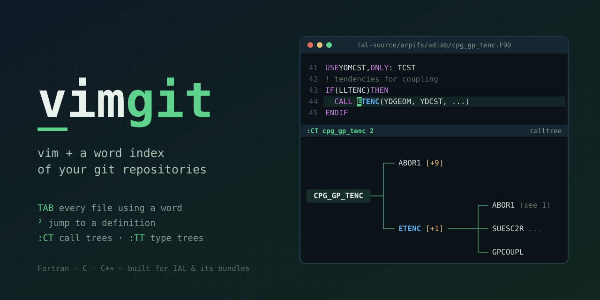

# vimgit



vimgit is vim with a word index of your source code. In one keystroke it finds
every file using a word, the definition of a routine, a module or a type, or a
file from its name, across one or several git repositories. It was written for
Fortran codes such as IAL (ARPEGE/IFS/ALADIN) and the libraries of their
bundles, and also indexes C and C++.

## Requirements

- vim compiled with Perl (`vim --version | grep +perl`);
- git: `/bin/git`, or the one given by the `git` setting of
  `~/.vimgit/config` (see [Configuration](#configuration));
- Perl modules `DB_File` and `local::lib`; for the transforms (`:T`), also
  `XML::LibXML`, `XML::XPath`, `List::MoreUtils`, and
  [fxtran](https://github.com/pmarguinaud/fxtran) with its Perl module.

`vimgit` can be run through a symbolic link (for example from `~/bin`).

## Quick start

In a git repository:

```
vimgit -i          # build the index (once per commit; incremental changes are followed)
vimgit cpg.F90     # open a file by its name, from anywhere in the repository
```

In a directory holding several repositories (an ecbundle `source/` directory):

```
cd source
vimgit -i          # writes .vimgit/config listing the repositories, then indexes them
vimgit
```

## Starting vimgit

```
vimgit [options] [file ...]
```

Files can be given by name (`cpg.F90`), by path (`../adiab/cpg.F90`), with a
line (`cpg.F90:120`, `cpg.F90(120)`) and a column (`cpg.F90:120.8`). When a
name matches several files, vimgit asks which one to open.

| Option | |
|---|---|
| `-i [repo ...]` | build the missing indexes (of all repositories, or of those named) |
| `-I [repo ...]` | build the indexes again, even if they exist |
| `-j N` | indexes built at the same time (default: the `jobs` setting, 4) |
| `-c` | print the settings in use, and the file and line each one comes from |
| `-v` | log to `.vimgit/log`; with `-i`/`-I`, list the indexed files |
| `-g` | run gvim |
| `-b` | read a backtrace (Intel, DrHook, EC_DRHOOK) on the standard input or from the files given, and open each location |

## Workspace

vimgit works in a *workspace*:

1. the directory holding `.vimgit/config`, looking upward from the current
   directory;
2. otherwise, the git repository containing the current directory;
3. otherwise, the current directory: vimgit lists the git repositories it
   contains (symbolic links followed; aliases and links into a repository
   skipped) and writes `.vimgit/config`.

vim runs at the top of the workspace; files are shown as `<repo>/<path>`.

## Configuration

Settings come from two files, both optional, both Perl:

1. `~/.vimgit/config`, your personal settings, for every workspace;
2. the `.vimgit/config` of the workspace, read next: it adds to the personal
   settings or overrides them.

[`config.sample`](config.sample) lists every setting with its default and a
comment: copy it to `~/.vimgit/config` to start.

```perl
# ~/.vimgit/config

git       '/home/me/install/git/bin/git';
vim       'vim';
jobs      8;                    # indexes built at the same time (-j wins)
results   200;                  # results per page
gitgrep   200;                  # above this many files, git searches
context   2;                    # lines shown around a match
keep      3;                    # indexes kept per repository
depth     6;                    # default depth of :CT :CTR :TT :TTR
atdepth   5;                    # default depth of :AT and :ATD
fxtran    'fxtran';             # fxtran binary, for :AT on fixed form files

blacklist qw (DR_HOOK MPL_*);   # routines left out of call trees (any case, * allowed)
exclude   fiat => 'src/fiat/mpl/internal_deprecated/**';
index     qw (*.F90 *.F *.h);   # names of the files to index (any case), instead of
                                # *.f90 *.f *.c *.cc *.cpp *.h *.hpp

key       definition => '²', '<F2>';
```

```perl
# .vimgit/config of a workspace

repo      qw (ial-source fiat surfex);   # repositories; results follow this order
exclude   surfex => 'src/LIB/XRD44/**';  # files of a repository not to index
                                         # (gitignore pattern, relative to its top)
blacklist '-MPL_*';                      # remove MPL_* from the personal list
results   300;
```

- **Single values** (`git`, `vim`, `jobs`, `results`, `gitgrep`, `context`,
  `keep`, `depth`): the workspace file wins.
- **Lists** (`blacklist`, `index`): each file adds to the list; `'-name'`
  removes an entry, `'-'` empties the list. The first `index` replaces the
  default list.
- **`exclude <repo> => <pattern>`**: in `~/.vimgit/config`, `<repo>` is a mount
  name, applied to every workspace with a repository mounted under that name
  (for a workspace made of one repository, the name of its directory);
  `'-<pattern>'` removes a pattern, `'-'` all the patterns of the repository.
- **`repo`** belongs to `.vimgit/config` only. Repositories not listed are
  ignored; lines naming an alias, a sub-directory or something that is not a
  repository are reported and ignored.
- **`dir <name> => <path>`** and **`readwrite`**, also for `.vimgit/config`
  only: directories that are not git repositories (see
  [Directories without git](#directories-without-git)).
- **`key <action> => <keys>`**: the keys of an action, replacing its default
  keys:

  | action | default keys |
  |---|---|
  | `search` | `<TAB>` |
  | `search_window` | `<S-TAB>` |
  | `definition` | `²` `` ` `` `œ` |
  | `definition_window` | `<C-²>` |
  | `back` | `<BS>` |

The files are Perl: conditions and computed values work
(`git "$ENV{HOME}/bin/git" if (-x "$ENV{HOME}/bin/git");`). A syntax error
stops vimgit, with the file and line. `vimgit -c` (or `:CONFIG` in vim) prints
the settings in use, each with the file and line it comes from.

Files written by older versions of vimgit (`repo ial-source`, one keyword and
its words per line) are still read; `vimgit -c` prints them in the new format.
The environment variables `GITVIMGIT` and `VIMPACKVIM` and the file
`~/.vimgit.rc` are no longer used: set `git`, `vim` and `key` instead.

A `.vimgitignore` file (gitignore syntax) in any directory of a repository also
excludes files, for everyone using vimgit on that repository. An `exclude`
setting wins over a `!` line of a `.vimgitignore`.

Excluded files never appear in results or in the list of files to choose from;
they can still be opened by their path.

## Indexes

Each repository has its own index, in `.git/vimgit/<commit>-<digest>/`, built
for its current commit by `vimgit -i`. The digest covers the settings the index
depends on (`index`, the `exclude` patterns of the repository, the version of
the index format): after changing them, the index is missing, and `vimgit -i`
builds it. Workspaces sharing a repository with different settings each have
their own index. The `keep` (3) most recent indexes for the current settings
are kept; for other settings, the most recent one, for 30 days.

Besides words and file names, the index records, for Fortran files, the
routines each file defines (subroutines, functions, programs; not interface
blocks, nor routines contained in another routine, whose calls go to it), the
routines each one calls (`CALL` statements), the derived types
each file defines and their components of derived type. Call trees, type
trees and the definition key use them.

An index stays usable while you work: at the first search, the files changed
since its commit (committed, modified, untracked) are scanned again; a file
written in vim is scanned again at once; when HEAD moves (commit, checkout,
pull), this is done again. `:R` forces it, for changes made outside vim.
An index built for one of the last 10 commits is used; for older ones, run
`vimgit -i`.

A repository without an index is reported at start and searched with
`git grep` (slower).

## Directories without git

A workspace can also hold directories that are not git repositories, such as
the generated sources of a build directory:

```perl
# .vimgit/config
repo qw (ial-source fiat surfex phyex);

dir generated => '../build/.fxtran/generated';   # name => path (absolute, or
dir modi      => '../build/modi';                # relative to the workspace)

exclude generated => '*_parallel.F90';           # as for repositories
readwrite 'modi';                                # the others open read-only
```

- **Names:** files show as `<name>/<path>` (`generated/acbl89_openacc.F90`),
  and `:E generated/acbl89_openacc.F90` opens them; vim shows their real path.
  A name must not be a file or directory of the workspace.
- **Order:** `repo` and `dir` lines keep their order, for results and for
  choosing among several definitions.
- **Files:** the directory is walked, symbolic links not followed (neither to
  files nor to directories); hidden directories are walked too, except
  `.vimgit`. `index`, `exclude` and `.vimgitignore` files apply, with
  gitignore patterns matched by vimgit.
- **Index:** `vimgit -i` builds it in `<dir>/.vimgit/<digest>/`, with the date
  and size of each file. When vim starts, the directory is walked once:
  files added, changed or removed since the index are scanned again; a file
  written in vim is scanned again at once. A build made while vim runs is
  seen at the next start (`:R` does not walk directories again). A directory
  that is not writable has no index: it is searched with `git grep
  --no-index`.
- **Read-only:** files of a directory open with `readonly` set (`:w!` still
  writes), except for the directories listed by `readwrite` (a list, like
  `blacklist`).
- **Overlaps:** a directory inside another directory or a repository, or
  holding a repository, is reported: its files are indexed twice.

## In vim

| Key / command | |
|---|---|
| `<TAB>` | search the word under the cursor; in a result buffer, open the file or line under the cursor, or the next page on `<<<< >>>>` |
| `<S-TAB>` | same, in a new window |
| `` ` ``, `²`, `œ` | go to the definition of the routine (`CALL x`, `#include "x.intfb.h"`), module (`USE x`), type (`TYPE (x)`, `CLASS (x)`) under the cursor; on `%x`, list the lines using component `x`; a routine or a type with several definitions gives a list to choose from, the most likely first |
| `<C-²>` | same, in a new window |
| `<BS>` | go back |
| `:F word` | search a word in all repositories |
| `:FR word` | search a word in the repository of the current buffer |
| `:E file` | open a file, as on the command line |
| `:R` | rescan changed files (after changes made outside vim) |
| `:CT [name [depth]]` | call tree of a routine (the word under the cursor without a name): the routines it calls, and so on |
| `:CTR [name [depth]]` | tree of the routines calling it |
| `:TT [name [depth]]` | type tree of a derived type (the word under the cursor without a name): the types of its components, and so on |
| `:TTR [name [depth]]` | tree of the types using it |
| `:AT [name] [depth] [follow]` | the call sequences passing a variable as dummy argument `name` (the word under the cursor without a name) of the routine around the cursor |
| `:ATD [name] [depth]` | the calls passing variable or component `name` (`X`, `X%Y`; the one under the cursor without a name) down the call tree |
| `:T align_args`, `:T align_use` | align the declarations of dummy arguments; clean up and align `USE` statements (needs fxtran) |
| `:C` | make the current file a single link (done before each write) |
| `:CONFIG` | show the settings in use, and where they come from |

Results show 200 files at a time (the `results` setting); `<TAB>` on the `<<<< >>>>` line at the end
shows the next ones. When a definition is found in a single file, vimgit opens
it directly.

## Call trees

`:CT cpg_gp_tenc 2` writes `.vimgit/calltree=/cpg_gp_tenc.depth=2.txt` and
opens it, the cursor on `CPG_GP_TENC`:

```
                ┌── ABOR1 [+9]
                │
CPG_GP_TENC ────┤                  ┌── ABOR1 (see line 1)
                │                  │
                └── ETENC [+1] ────┼── SUESC2R ...
                                   │
                                   └── GPCOUPL
```

- each routine is in the middle of the routines it calls, on its right; the
  definitions are kept next to the tree (`cpg_gp_tenc.depth=2.loc`), for `²`;
- a routine is expanded once; later, `(see line N)`, or `(recursive, see line N)`;
- `[+n]`: other definitions exist; the one shown is, in this order, in the
  caller's file, in the caller's repository, in a file named after the
  routine, in the first repository of the config;
- a routine contained in another routine or a program (after `CONTAINS`) is
  not a node: its calls count as calls of the outermost routine, and calls
  to it are left out; it has no definition in the index (`²` on its name
  searches for it). Routines contained in a module are indexed as usual;
- `(not found)`: no definition in the indexed repositories;
  `(type-bound)`: `CALL x%y`, shown but not followed;
- `blacklist` names of the config are left out; `:CT cpg 3` stops at 3 levels
  (`...` marks routines not expanded).

In a tree, `<TAB>` on a name searches it, `²` opens its definition (a list for
`[+n]`); on `(see line N)`, both go to line N. Big trees are wide (`:CT cpg`:
4,531 lines, 535 columns): a depth limit keeps them small.

`:CTR rain_ice` shows the routines calling `RAIN_ICE` the other way, each
caller on the left of the routine it calls:

```
    CPG_DRV ... ──┐
                  ├──── CPG ─────── MF_PHYS ─────── APL_AROME ─────── ...
DO_PARALLEL ... ──┘
```

Only `CALL` statements are seen, not function calls; a call whose name is on a
continuation line (`CALL &` / `& NAME`) is missed.

## Type trees

`:TT mgrids_advection_args` writes `.vimgit/typetree=/mgrids_advection_args.txt`:

```
                          ┌── TYPE, EXTENDS (DWARF_ARGS)
                          │
                          │                                     ┌── TYPE (TYPE_T0) :: YT0
MGRIDS_ADVECTION_ARGS ────┤                                     │
                          │                                     ├── TYPE (TYPE_T9) :: YT9
                          │                                     │
                          │                                     ...
                          └── TYPE (TGMV), POINTER :: YRGMV ────┤
                                                                │
                                                                └── TYPE (TYPE_T0) :: YT5 (see line 3)
```

- each type is in the middle of its components of derived type (`TYPE (x)`,
  `CLASS (x)`), shown as declared, with `POINTER` or `ALLOCATABLE`; the
  parent type of `EXTENDS` comes first; components of intrinsic types and
  bound procedures are left out;
- a type is expanded once, then `(see line N)`; `[+n]`, `...`, `(not found)`
  as in call trees; the definition of a type is chosen with the rules of
  routines.

`²` on a type opens its definition (a list for `[+n]`), on a component the
line declaring it; `<TAB>` searches the word under the cursor.

`:TTR tcst` shows the types using `TCST`, on its left, as `MODEL%YRCST`
(component `YRCST` of `MODEL`), or `FIELDS (extends)`:

```
CLASS_SUPERGOM%MODEL_OBJ_PTR ──┐
                               │
         ERRMOD_FIELDS%MODEL ──┼──── MODEL%YRCST ──┐
...                                                ├──── TCST [+1]
```

## Argument traces

`:AT X`, in routine `BAR`, lists the calls that pass a variable as dummy
argument `X`, then the calls passing that variable to their caller, and so
on, up to the declaration of the first variable that is not a dummy
argument:

```
:AT X in BAR (bar.F90:1), depth 5

[1] foo1.F90                            FOO1 passes Y as X of BAR

     4 | Z = 0
     5 | CALL ABC (Z)
     6 | CALL BAR (Y)
       |           ^
     7 | Z = Y + 1
     8 | CALL DEF (Z)

[1.1] foo2.F90                          FOO2 passes Y2 (I) as Y of FOO1
...
[1.1.1] foo2.F90                        Y2 is local to FOO2

     2 | INTEGER :: I
     3 | REAL :: Y2 (10)
       |         ^^
     4 | REAL :: ZW

[2] foo6.F90                            FOO6 passes XM as X of BAR

[2.1] foo6.F90                          XM comes from module YOMX
```

- one block per call, depth-first, numbered after its place in the sequences;
  the `CALL` statement with 2 statements before and after it, carets under
  the argument; `see [1.1]` for a call already shown;
- arguments are matched by position or keyword; `ASSOCIATE` names are
  replaced by their selector; a dummy argument of the host counts for a
  contained routine, whose calls are searched in its host;
- a chain ends with a local variable (pointers included), a module
  (`USE ... ONLY`, a variable of the module, or one of the modules used
  without `ONLY`), a literal, an expression, or an optional argument not
  passed;
- a component of a dummy argument (`YD%T%T0`) stops the chain; `:AT X follow`
  goes on with `YD`;
- `:AT X 10` goes 10 levels up (the `atdepth` setting, 5 by default);
- `<TAB>` or `²` on a line opens the file there; on a `see` line, they go to
  the block.

`:ATD X` goes the other way: from a variable of a routine (a dummy argument,
a local, a module variable), the calls passing it, then the calls passing it
further in the callees, and so on:

```
:ATD YDVARS%T in CPG (cpg.F90:1), depth 3

[1] cpg.F90                             CPG passes YDVARS as YDVARS of CPG_GP (tracing YDVARS%T)
...
[1.1] cpg_gp.F90                        CPG_GP passes YDVARS%T%T0 as P0T of GPTF2_EXPL_3TL_PART1
...
[1.1.1] gptf2_expl_3tl_part1.F90        P0T is not passed further by GPTF2_EXPL_3TL_PART1
```

- what is traced is what the cursor is on: on `YDVARS` in `YDVARS%T%T0`,
  `YDVARS`; on `T`, `YDVARS%T`; `:ATD YDVARS%T` gives it by name;
- a call is shown when it passes what is traced (`X%Y`, `X%Y(:,1)`), the
  variable it belongs to (`X`: the callee's `D%Y` is traced), or a part of it
  (`X%Y%Z`: the callee's dummy argument is traced); `ASSOCIATE` names are
  replaced by their selector, subscripts are ignored;
- calls are searched in the routine and in the routines it contains that do
  not declare the name; the callee is a contained routine of the file, or
  the definition chosen as for `²`;
- a chain ends when the variable is not passed further (the declaration of
  the dummy argument is shown), on a callee not found or not parsed, a
  recursive call, or the depth (`atdepth`, `:ATD X 10`).

Callers come from the call index; the files are parsed by fxtran (the
`fxtran` Perl module, and the `fxtran` binary for fixed form files), once
per session. Type-bound calls, generic interfaces and function arguments
are not followed.
